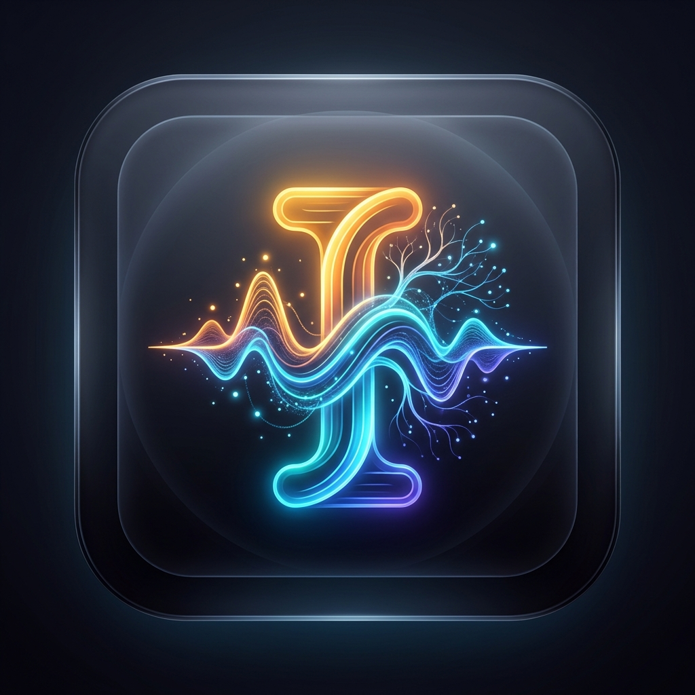

<p align="center">
  
</p>

# ISHA AI — Intelligent Speech & Haptic Assistant
> **"Minimum Compute. Maximum Intelligence. Structure does the thinking. Model does the speaking."**

ISHA AI is a privacy-first, on-device AI cognitive runtime designed to run natively on smartphones and personal computers — without requiring cloud subscriptions or permanent internet connectivity, while supporting **Online Live RAG** when internet is accessible.

---

## 🌟 Key Features

### 1. 🎨 Google Stitch UI Design System
- **Ultra-Modern Canvas Layout**: Frosted glass surfaces (`backdrop-filter: blur`), glowing saffron (`#f59e0b`) & electric cyan (`#06b6d4`) accents, and clean micro-interactions.
- **Dark & Light Mode**: Seamless theme switching with persistent client state.
- **Live Mode Beacon**: Real-time indicator displaying **Device Offline Mode** vs. **Online Live Mode (Live RAG)**.
- **Hardware Tier Badges**: Real-time status for simulated Tier 1 (4GB Budget), Tier 2 (8GB Standard), and Tier 3 (16GB+ Flagship).

### 2. 🌐 Online Live RAG & MCP Architecture
- **Real-Time Web Search & Scraping**: Connects directly to DuckDuckGo and Wikipedia REST APIs to fetch live web information.
- **Privacy Sanitization Layer**: Automatically scrubs phone numbers, emails, location identifiers, and personal data locally *before* transmitting search queries.
- **Grounded Citations**: Synthesizes responses with structured citations `[W1]`, `[W2]` linked to live source articles and domains.

### 3. 📚 Knowledge Base Studio & Domain Packs
- **Pre-Bundled Domain Packs**:
  - 🌾 **Kisan Saathi**: Crop disease diagnostics (wheat rust, blast), fertilizer dosages (NPK, DAP), drip irrigation, PM-Kisan.
  - 🩺 **Swasthya Rakshak**: Pediatric paracetamol dosing, ORS preparation, burn first aid, dengue danger signs, CPR.
  - ⚖️ **Bharat Vidhi**: Fundamental Rights (Articles 14-32), police FIR filing guidelines, Consumer Protection Act, emergency helplines (112, 108, 1091, 1930).
  - 🎓 **Shiksha Prep**: STEM formulas, Newton's laws, thermodynamics, calculus, and biology cycles.
- **Document Ingestion Pipeline**:
  - Drag-and-drop support for `.pdf`, `.docx`, `.txt`, `.md`, `.csv`, `.json`.
  - **Boundary-Aware Semantic Chunker**: Preserves tables, bullet points, and numbered lists (250 words target, 32 overlap).
  - **SHA-256 Deduplication**: Prevents duplicate chunk indexing.
  - **EdgeFlatVectorIndex**: Fast character 3-gram TF-IDF normalized 64-D vector index with BM25-lite keyword fallback.

### 4. 👁️ Vision & Multimodal Studio
- **Crop Disease Diagnostics**: Identifies Wheat Yellow Rust, Rice Blast, and Nitrogen Chlorosis with confidence metrics and treatment remedies.
- **Prescription & Document OCR**: Identifies medical dosages and validates safety baselines.
- **Frame Governor**: 5 FPS cap and thermal throttling prevention.

### 5. 🎙️ Voice STT & Waveform Audio
- **Speech-to-Text (STT)**: Web Speech API microphone dictation.
- **Waveform Pulse Visualizer**: Real-time HTML5 Canvas waveform animation during speech input and output.
- **Text-to-Speech (TTS)**: High-clarity audio speech synthesis.

### 6. ⚡ Runtime Watchdog & Telemetry
- **Dynamic Degradation Ladder**: Simulates thermal transitions across Zone 1 Normal (<38°C), Zone 2 Warm (38-42°C), Zone 3 Hot (42-46°C), and Zone 4 Critical (>46°C).
- **Resource Profiler**: Tracks Process RSS memory, system RAM %, CPU %, and KV Cache occupancy in real time.

---

## 🚀 Quick Start (1-Click Launch)

### Option A: Windows 1-Click Batch File
Double-click `run_isha.bat` in the repository root.

### Option B: Python CLI
```bash
python run_isha.py
```

### Option C: PowerShell
```powershell
.\run_isha.ps1
```

Once launched, ISHA AI automatically opens your default browser at:
```
http://127.0.0.1:8000
```

---

## 🧪 Running the Verification Test Suite

Verify all 7 core capability subsystems (Knowledge Packs, Live RAG, Ingestion, Streaming, Vision, Watchdog) with:
```bash
python test_isha_runtime.py
```

Expected output:
```
=== ISHA AI Comprehensive Verification Suite ===
--- Test 1: Grounded Knowledge Pack Retrieval (Kisan Saathi) --- [PASSED]
--- Test 2: Health Knowledge Pack Retrieval (Swasthya) --- [PASSED]
--- Test 3: Online Live RAG (DuckDuckGo + Wikipedia) --- [PASSED]
--- Test 4: Document Ingestion Pipeline --- [PASSED]
--- Test 5: Full Streaming Cognitive Pipeline --- [PASSED]
--- Test 6: Vision & Multimodal Analysis --- [PASSED]
--- Test 7: Runtime Telemetry & Watchdog --- [PASSED]
>>> ALL 7 CORE CAPABILITY TESTS PASSED WITH 100% SUCCESS! <<<
```

---

## 🛠️ Project Directory Structure

```
├── backend/
│   ├── app.py                     # FastAPI REST API & WebSocket server
│   ├── isha_engine.py             # Central cognitive runtime coordinator
│   ├── rag/
│   │   ├── index.py               # EdgeFlatVectorIndex (Cosine + BM25-lite)
│   │   ├── embeddings.py          # Character 3-gram TF-IDF embedding engine
│   │   ├── chunker.py             # Semantic boundary-aware text chunker
│   │   ├── document_parser.py     # PDF, DOCX, TXT, MD, CSV, JSON parser + SHA-256
│   │   ├── knowledge_packs.py     # Kisan Saathi, Swasthya, Bharat Core, Shiksha
│   │   ├── online_rag.py          # Live web search (DDG, Wikipedia) & PII scrubber
│   │   └── hybrid_retriever.py    # Local pack + Live web hybrid retriever
│   ├── cognition/
│   │   ├── context_governor.py    # Hardware token budget controller
│   │   └── grounded_pipeline.py   # Grounded prompt synthesis & citation manager
│   ├── inference/
│   │   └── model_provider.py      # On-device cognitive engine + Gemini/OpenAI fallback
│   ├── vision/
│   │   └── vision_engine.py       # Crop pathology & OCR vision engine
│   ├── voice/
│   │   └── voice_service.py       # Audio transcription & TTS speech synthesis
│   └── telemetry/
│       └── monitor.py             # Hardware tiers, thermal zones, memory guard
│
├── frontend/
│   ├── index.html                 # Google Stitch single-page application
│   ├── css/stitch.css             # Stitch glassmorphic design system
│   └── js/stitch-app.js           # Reactive UI, WebSockets, STT/TTS & audio visualizer
│
├── core/                          # Native C++ edge runtime & survival layers
├── android/                       # Native Android JNI app & thermal service
├── benchmarks/                    # C++ benchmarks
├── run_isha.py                    # Production launcher
├── run_isha.bat                   # 1-click Windows launcher
├── run_isha.ps1                   # PowerShell launcher
└── test_isha_runtime.py           # Verification test suite
```

---

## 📱 Multi-Tier Phone Architecture & Dynamic Hybrid Routing

ISHA AI dynamically detects device RAM and hardware profiles to select the optimal inference engine without out-of-memory (OOM) crashes:

| Phone Tier | Hardware Profile | Architecture Strategy | Free Engines & Deployment |
| :--- | :--- | :--- | :--- |
| **Tier 1: Budget Mobile** (₹8,000 – ₹12,000) | 3GB–4GB RAM, MediaTek/Unisoc, No NPU | **100% Free Cloud Offload + Zero-RAM Local RAG** (Prevents OOM crashes) | **Google AI Studio** (Gemini 2.5/1.5 Flash Free Tier), **Groq Cloud** (Llama 3.2 3B / Llama 3.3 70B), **Hugging Face** (FLUX.1 [schnell] for images). Local vector search via MiniLM-L6-v2 (~90MB). |
| **Tier 2: Mid-Range** (₹13,000 – ₹20,000) | 6GB–8GB RAM, Snapdragon 4 Gen 2 / Dimensity 6080 | **Hybrid Execution** (Local Quantized SLMs + Cloud Image Offload) | **Local Quantized SLM** (Qwen 2.5 0.5B/1.5B Q4, Llama 3.2 1B GGUF) for offline text. Cloud offload for heavy image generation. |
| **Tier 3: Flagship** (₹25,000+) | 12GB–16GB+ LPDDR5X RAM, Snapdragon 8s/8 Gen series | **100% Full On-Device Execution** (Zero cloud costs) | **On-Device Heavy SLMs** (Phi-3.5-mini 3.8B, Gemma 2 2B) + **On-Device Mobile Vision / MobileDiffusion** (520M) via NPU. |

---

## 🔧 Free Cloud AI API Providers

ISHA AI operates **100% offline out-of-the-box** using its zero-RAM native grounded cognitive generator. For enhanced cloud capabilities, configure any generous free tier without credit cards:
- **Google AI Studio (Gemini 2.5/1.5 Flash)**: Set `GEMINI_API_KEY` (Free 1M token context tier)
- **Groq Cloud (Llama 3.3 70B / Llama 3.2 3B)**: Set `GROQ_API_KEY` (Ultra-fast near-instant token streaming)
- **Hugging Face Serverless (FLUX.1 [schnell] / SD 1.5)**: Set `HF_TOKEN` (Free serverless text-to-image generation)
- **Ollama**: Local LLMs running on `http://localhost:11434`
- **OpenAI**: Set `OPENAI_API_KEY` for GPT-4o-mini compatibility
