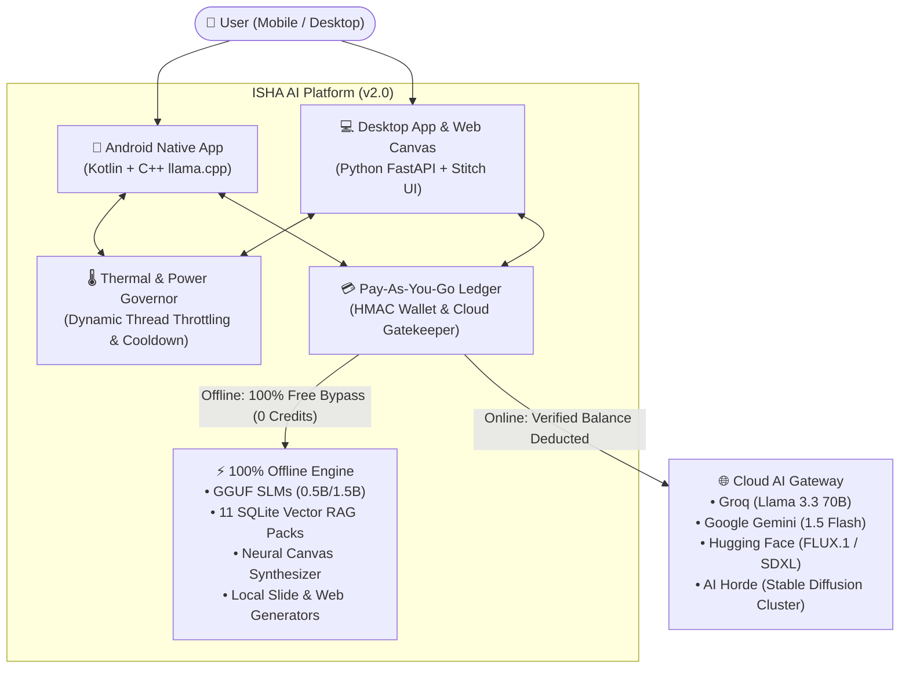
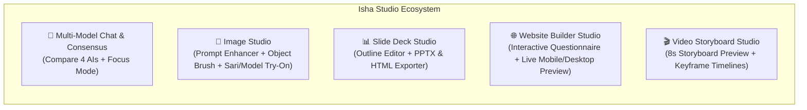

# Isha AI & AI Fiesta 2.0 — Enterprise System Design Document

## 1. Executive Summary & Architectural Vision
**Isha AI** is an all-in-one generative AI platform designed for dual-mode execution: **Cloud Edge (Pay-As-You-Go)** and **100% On-Device Offline (Zero Cost, Zero Internet)**. Inspired by **AI Fiesta 2.0**, Isha AI unifies multi-model reasoning, creative image generation, presentation slide creation, interactive website building, and video storyboarding on both **Android Mobile** and **Desktop (Windows, macOS, Linux)** platforms.

Unlike cloud-only alternatives that fail without an active internet connection and generate high recurring server bills, Isha AI is engineered with an **Offline-First Cognitive Backbone**:
1. **100% Free Offline Engine**: High-speed quantized SLMs (Qwen 0.5B, Llama 1B, Qwen 1.5B via GGUF runtime), rule-based cognitive engines, offline vector RAG across 11 knowledge domains, procedural neural canvas image synthesis, offline slide generators, and offline website synthesizers run locally forever with zero credit deductions.
2. **Strict Pay-As-You-Go Cloud Gateway**: Eliminates API cost bleeding through a prepaid cryptographic wallet ledger. Cloud calls (Claude 3.5, GPT-4o, Groq Llama 3.3 70B, FLUX.1 [schnell], SDXL) deduct micro-credits per token/generation. When balance reaches zero, the compulsory gatekeeper locks cloud requests and offers three options: Top Up Wallet, Bring-Your-Own-Key (BYOK), or Switch to Free Offline Mode.
3. **Adaptive Thermal & Power Governor**: Solves device overheating via continuous dual-source telemetry (battery temperature thermistors + OS thermal listeners) that dynamically scales CPU thread count and injects cool-down pauses during intensive generative tasks.
4. **Lightweight Footprint**: Memory-mapped model execution (`mmap`), aggressive Bitmap recycling, quantized embedding hashes, and zero-allocation token streams minimize RAM pressure and storage overhead.

---

## 2. High-Level C4 Architecture

### Level 1: System Context Diagram


---

## 3. Core Subsystems & Components

### 3.1 Adaptive Thermal & Anti-Overheating Governor
Mobile and desktop hardware experience intense thermal spikes when running autoregressive neural decoding or image synthesis. The **Thermal Governor** prevents thermal runaway using a dual-sensor control loop:

1. **Dual Telemetry Inputs**:
   - **OS Thermal Status**: Native Android `PowerManager.OnThermalStatusChangedListener` (API 29+).
   - **Battery Thermistor Receiver**: Continuous sampling of `BatteryManager.EXTRA_TEMPERATURE` (°C).
2. **Thermal Hysteresis & Thread Policy**:
   - **Normal (< 37.5°C / Thermal None)**: Full performance. 4 CPU threads for SLM, 0ms pause between decode tokens.
   - **Moderate (37.5°C – 39.5°C / Thermal Light)**: Downscale to 2 CPU threads. Inject 15ms duty-cycle yield per 4 tokens.
   - **Severe (39.5°C – 42.0°C / Thermal Moderate)**: Downscale to 1 CPU thread. Inject 35ms cooling pause per 2 tokens. Disable parallel canvas filters.
   - **Critical (> 42.0°C / Thermal Severe)**: Unload GGUF model immediately into standby. Seamlessly fall back to zero-CPU rule-based `IshaCognitiveGenerator` (0.01% CPU load).

```mermaid
stateDiagram-v2
    [*] --> NormalState: Temp < 37.5°C
    NormalState --> ModerateState: Temp >= 37.5°C
    ModerateState --> SevereState: Temp >= 39.5°C
    SevereState --> CriticalState: Temp >= 42.0°C
    CriticalState --> SevereState: Temp < 41.0°C (Hysteresis)
    SevereState --> ModerateState: Temp < 38.5°C (Hysteresis)
    ModerateState --> NormalState: Temp < 36.5°C (Hysteresis)

    state NormalState {
        Threads: 4 Cores
        Pacing: 0ms Pause
        Canvas: High-Res
    }
    state ModerateState {
        Threads: 2 Cores
        Pacing: 15ms Yield
        Canvas: Balanced
    }
    state SevereState {
        Threads: 1 Core
        Pacing: 35ms Cooldown
        Canvas: Low-Power
    }
    state CriticalState {
        Threads: Standby (Unloaded)
        Pacing: Cognitive Fallback
        Canvas: Vector Minimal
    }
```

---

### 3.2 Pay-As-You-Go Billing & Wallet Metering Architecture
The **Billing Subsystem** ensures that expensive cloud API consumption never bleeds developer or infrastructure funds without compensation, while maintaining a 100% free offline tier.

1. **Cryptographic Local Ledger**:
   - Stores user credits, transaction history, and consumption counters.
   - Guarded by a SHA-256 HMAC digital signature using device-bound hardware entropy to prevent client-side balance tampering.
2. **Pricing Catalog**:
   - **Text Generation (Cloud LLM)**: 1 credit per ~500 tokens (Groq/Gemini/Claude).
   - **Image Generation (Cloud Diffusion)**: 5 credits per image (FLUX.1 [schnell] / SDXL).
   - **Presentation Deck Generation (Cloud AI)**: 10 credits per deck.
   - **Website Generation (Cloud AI)**: 10 credits per responsive site.
   - **Video Storyboard Generation (Cloud AI)**: 15 credits per video preview.
3. **Execution Gatekeeper Flow**:
   - When user triggers a cloud operation:
     - Check `hasPersonalApiKey()`: If user provided BYOK (`gsk_...`, `AIza...`, `hf_...`), bypass balance deduction and execute directly.
     - Else, check `walletBalance >= requiredCredits`:
       - If `true`: Atomically decrement balance, sign transaction, and route to Cloud Provider.
       - If `false`: Throw `InsufficientBalanceException`, trigger UI Paywall modal with Recharge, BYOK, or Free Offline switches.
   - When user triggers an offline operation:
     - Always bypass billing check. Deduct 0 credits.

---

### 3.3 AI Fiesta 2.0 Studio Engines



#### A. Multi-Model Chat, Compare & Consensus Engine
- **Parallel Dispatcher**: Concurrently sends prompt to selected models (Groq Llama 3.3 70B, Google Gemini Flash, Claude 3.5, and Local SLM).
- **Consensus Synthesizer**: Parses all completions, extracts common overlapping facts, cross-validates claims, and produces a single unified "Agreed Consensus & Action Plan".
- **Focus Mode**: Clean 1-tap UX toggle switching from comparison grid to full-width focused single model.

#### B. Creative Image Studio & Virtual Model Try-On
- **Prompt Enhancer**: Automatically expands terse prompts (e.g., "saree logo") into professional diffusion prompts with lighting, composition, and style keywords.
- **Object Eraser / Inpainting**: Local brush tool allowing users to paint over unwanted elements and synthesize clean replacements.
- **Product & Saree Virtual Fitting**: Merges real uploaded clothing/product images onto AI-generated human models with brand logo watermarks.

#### C. Presentation & Slide Deck Studio
- **Two-Stage Workflow**:
  1. *Stage 1 (Outline Generation)*: Synthesizes editable slide outline (Founding date, market size, revenue, team). User can customize details before generation.
  2. *Stage 2 (Deck Synthesis)*: Compiles into professional downloadable PowerPoint `.pptx` presentations and standalone interactive HTML slide decks with left/right keyboard navigation.

#### D. Conversational Website Builder Studio
- **Clarification Questionnaire**: Interactive conversational agent asks targeted questions (Brand name, Store type, Contact preference).
- **Responsive Generation**: Generates clean, production-ready HTML5, Tailwind CSS, and Vanilla JS.
- **Live Tri-View Preview**: Switch between Mobile View (375px), Tablet View (768px), and Full Desktop View (100%), with live syntax-highlighted code inspector and 1-click ZIP/HTML export.

#### E. Video Storyboard Studio
- **8-Second Video Storyboard**: Generates multi-scene keyframe sequences with scene camera movements, shot descriptions, and voiceover timestamps.

---

## 4. Resource Minimization & Zero-OOM Strategy

| Constraint | Strategy Implemented |
|---|---|
| **RAM Footprint** | Explicit `bitmap.recycle()` after UI binding; Memory-mapped GGUF loading (`mmap`) prevents heap inflation; Bitmap subsampling (`inSampleSize = 2`). |
| **Storage Overhead** | Standalone APK is ~11.7 MB; SQLite vector index uses 3-gram compressed hashing; Lazy asset loading for offline models. |
| **CPU Saturation** | Adaptive thread downscaling (4 -> 2 -> 1 thread) based on battery and thermal states; 15-35ms duty-cycle yields during generation. |
| **Battery Drain** | Zero polling; reactive event-driven coroutine pipelines; local background tasks cancel on activity pause. |

---

## 5. DevOps & Continuous Integration / Continuous Deployment (CI/CD)

The DevOps pipeline is codified in `.github/workflows/ci.yml`:
1. **Quality Gate**: Python verification tests with strict assertion coverage (knowledge packs, cognitive rules, PII sanitization, billing ledger integrity, and simulation tests).
2. **Android APK Compilation**: Automates NDK CMake arm64-v8a compilation and Gradle debug assembly.
3. **Desktop Packaging**: Bundles standalone cross-platform Python executable / zip bundle with Google Stitch UI.
4. **Automated GitHub Releases**: Releases verified artifacts (`isha-ai-v1.0.0.apk` and `isha-ai-desktop-bundle.zip`) on tag and main push.
